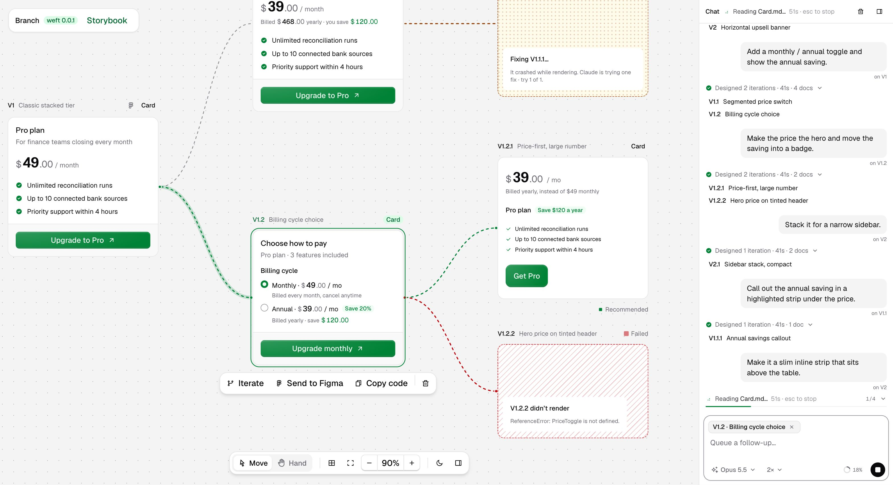

# Branch

 

**Live demo:** [branch-fawn.vercel.app](https://branch-fawn.vercel.app) (view-only: prompting needs your local Claude Code, so run it locally to design)

> **Alpha.** This is my own design workflow, shared as a demo. Expect rough edges and breaking changes.



Branch helps designers iterate more, faster, and stay organized.

- **Design in real code.** There are no design frames. Every iteration is live, running code built from your own design system's components.
- **Iterate in branches.** Prompt a component, get several versions, pick any one and branch it again.
- **Stay organized.** Every iteration stays on one canvas with its prompt, so you can come back and review how a design evolved.

All AI work runs through **your Claude Code session** (`claude -p`): no API key.

## Run

```sh
npm install
npm run dev            # http://localhost:3000
```

**Alpha setup note:** `package.json` still points at my private design system
(`@greenloom-ai/weft`, packed into `vendor/`, which isn't in this repo). To try Branch,
remove that dependency line, run `npm install`, then connect your own design system
(below).

You need Claude Code installed and signed in (`claude`), with the Figma MCP connected
for Send to Figma (`claude mcp list`). No local login? Run `claude setup-token` and put the
token in `.env.local` as `CLAUDE_CODE_OAUTH_TOKEN`.

## Connect a Storybook

Use the Connect screen, or:

```sh
npm run connect -- <path to your design-system repo> [storybook url]
```

It finds the package with `.storybook`, packs and installs it (works for private
packages, nothing is downloaded), copies its agent docs (a Claude skill folder with
`SKILL.md`; falls back to the package's type definitions), and writes `branch.config.json`.
Restart `npm run dev` afterwards.

## How it works

| Step | What happens | Code |
|---|---|---|
| Design | Claude Code reads the design system's `SKILL.md` + component docs (read-only tools, no MCP) and returns N variants as TSX | `src/app/api/generate/route.ts`, `src/lib/claude.ts` |
| Render | A sandboxed iframe compiles the TSX (sucrase), renders it with the real package, and compiles Tailwind classes in the browser against the design system's theme | `src/app/(render)/render/` |
| Fix | If a render throws, the error goes back to Claude once | `src/components/studio.tsx` |
| Figma | The iframe snapshots the rendered design as self-contained HTML; Claude Code gets a one-time upload URL from the Figma MCP (`html_to_figma`); the server posts the HTML to it | `src/app/api/figma/route.ts` |

Iterations are kept in the browser (localStorage).
